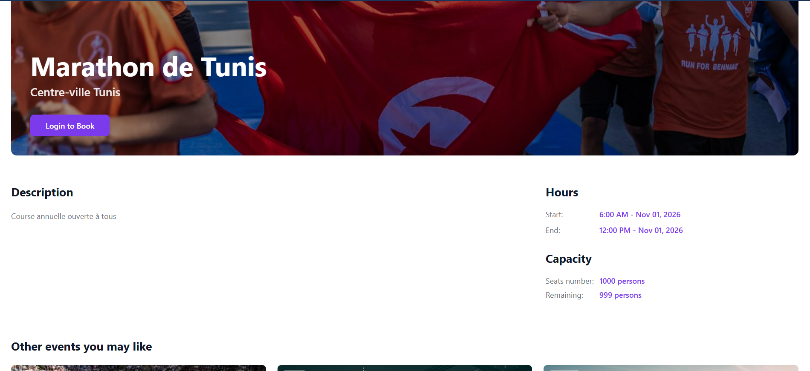
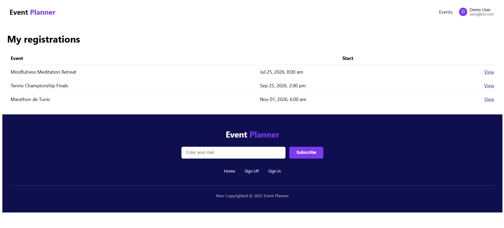
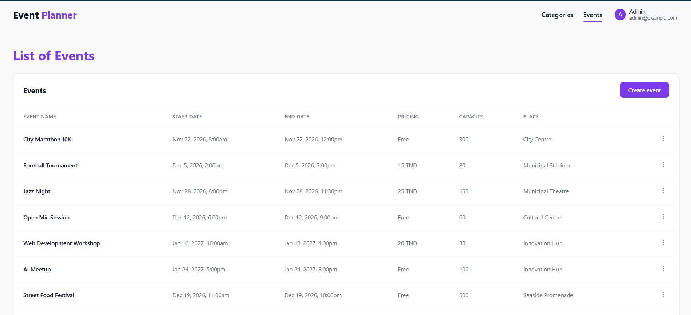
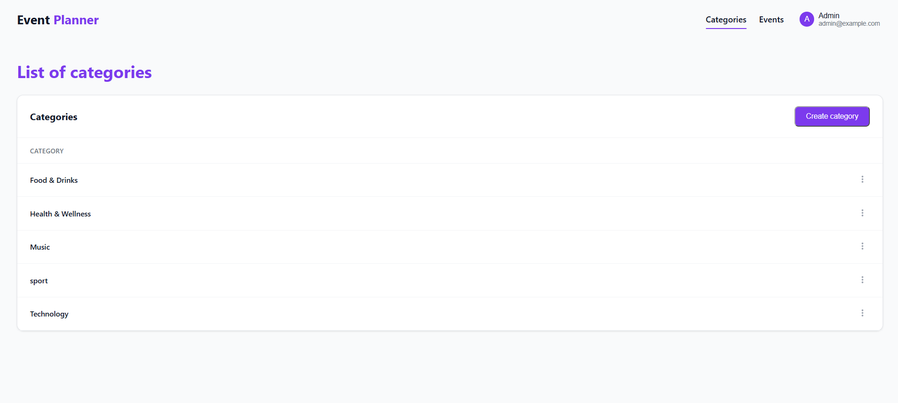

# 🎟️ Event Planner — Laravel event management platform

A web application to publish events and let users register for them, with an **administration area** and a
**REST API secured with Laravel Sanctum**. The project also comes with a **software testing and quality report**:
static analysis, Selenium tests, Postman API tests and a code inspection.


---

## ✨ Features

**Visitors and users**
- Browse upcoming events, with **search** (title, description, place) and **category filter**
- Event page with details, price or "free", **remaining places** and related events
- Sign up / sign in, profile page
- **Register for an event** (refused when the event is full) and cancel a registration
- "My registrations" page

**Administrators**
- Manage **categories** (a category whose events already have registrations cannot be deleted)
- Manage **events**: create, edit, delete, **archive / restore**
- List of all **registrations**
- Access protected by an `admin` middleware

**REST API** (Laravel Sanctum, token authentication)

| Method | Endpoint | Description |
|---|---|---|
| POST | `/api/login` | Returns a token (public) |
| POST | `/api/logout` | Revokes the current token |
| GET / POST | `/api/categories` | List / create categories (admin) |
| GET / PUT / DELETE | `/api/categories/{id}` | Show / update / delete a category (admin) |
| GET / POST | `/api/events` | List / create events (admin) |
| GET / PUT / DELETE | `/api/events/{id}` | Show / update / delete an event (admin) |
| PATCH | `/api/events/{id}/archive` | Archive an event (admin) |

Requests without a valid token get `401 Unauthorized`; requests from a non-admin user get `403`.

## 📸 Screenshots

| Event page | My registrations |
|---|---|
|  |  |

| Admin – events | Admin – categories |
|---|---|
|  |  |

## 🧪 Testing and quality

The full report (in French) is in [`docs/Test-and-Quality-Report-FR.pdf`](docs/Test-and-Quality-Report-FR.pdf).

| Area | Technique | Tool | Result |
|---|---|---|---|
| Static analysis | Code analysis, level 5 | PHPStan + Larastan | No errors |
| Sign-up form | Black box: equivalence classes (7 cases) and boundary values (18 cases) | Selenium (Python) | 25/25 after fixing the validation rules |
| Sign-in form | Black box: equivalence classes | Selenium (Python) | 4/4 |
| Admin CRUD (API) | Black box, integration | Postman | 8/8 |
| Access without token | Security, integration | Postman | 8/8 (`401`) |
| Unique category name | Data integrity | Postman | 4/4 |
| Error messages | Usability | Manual | 4/5 (one message to improve) |
| CSRF protection | White box, code inspection | — | 12/12 forms |

The tests found real defects that were then fixed: missing uppercase/digit rules on the password,
and missing maximum lengths (a 256-character e-mail caused an SQL error).

```bash
vendor/bin/phpstan analyse          # static analysis
python test/inscription.py          # Selenium – sign-up (needs: pip install selenium)
python test/login_test.py           # Selenium – sign-in
```

## 🚀 Getting started

**Requirements:** PHP 8.2+, Composer, MySQL or MariaDB (XAMPP / Laragon work fine).

```bash
git clone https://github.com/MaatarChaima/event-planner.git
cd event-planner
composer install
cp .env.example .env            # then set DB_DATABASE / DB_USERNAME / DB_PASSWORD
php artisan key:generate
php artisan migrate --seed      # tables + admin account + demo data
php artisan serve               # http://127.0.0.1:8000
```

Create an empty database named `event_planner` (or the name you put in `.env`) before running the migrations.

### Demo accounts

| Role | E-mail | Password |
|---|---|---|
| Admin | `admin@example.com` | `password` |
| User | `user@test.com` | `Password123` |

The demo categories and events are fictional; event pictures come from [picsum.photos](https://picsum.photos).

## 📁 Project structure

```
app/Http/Controllers/          Public pages, authentication, registrations
app/Http/Controllers/Admin/    Admin area (categories, events, registrations)
app/Http/Controllers/Api/      REST API (Sanctum)
app/Http/Middleware/           AdminMiddleware
app/Models/                    User, Category, Event, Registration
database/migrations/           Database schema
database/seeders/              Admin account and demo data
resources/views/               Blade templates
test/                          Selenium tests (Python)
docs/                          Test report and screenshots
```

## 👩‍💻 Author

**Chaima Maatar** — [GitHub](https://github.com/MaatarChaima)

Academic project — IIT Sfax, 2025/2026 (Software Testing & Quality course).
